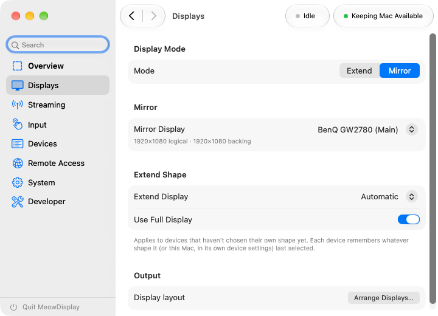
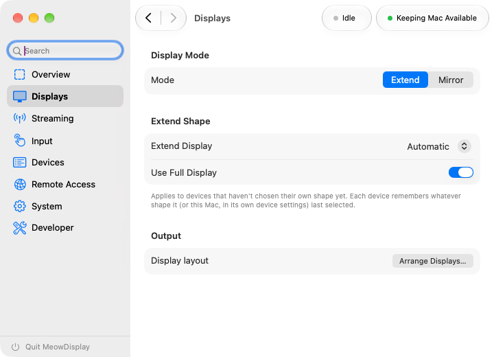
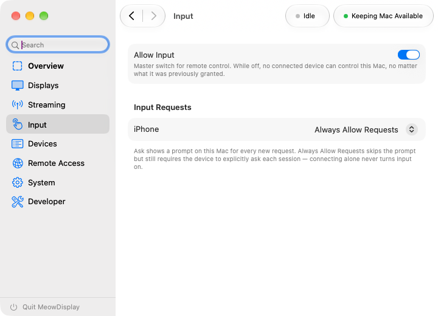
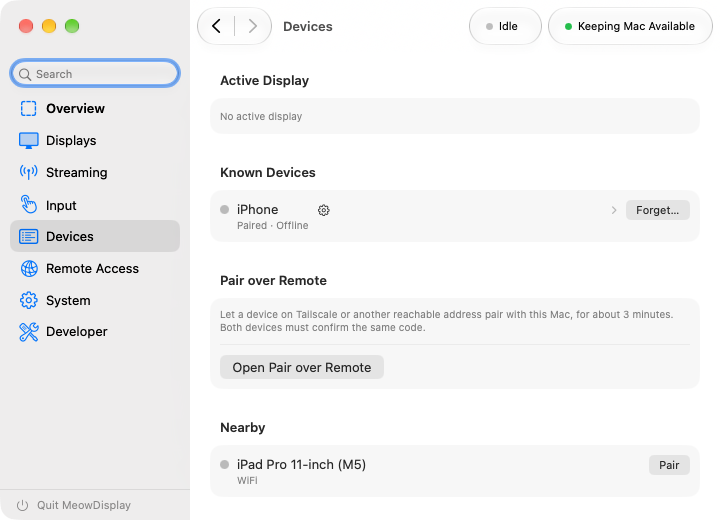

<div align="center">


# MeowDisplay

**Mac Everywhere, On Whatever Display**

Use MeowDisplay to mirror, extend or view individual Mac windows on your
iPhone or iPad. Control your Mac with touch, a trackpad-style pointer,
shortcuts and a keyboard. Another Mac can also act as a receiver; Android
is available through closed testing.

[Website](https://meowdisplay.app) ·
[Features](https://meowdisplay.app/features.html) ·
[Setup](https://meowdisplay.app/docs.html) ·
[Support](https://meowdisplay.app/support.html) ·
[Privacy](https://meowdisplay.app/privacy.html) ·
[Support on Ko-fi](https://ko-fi.com/raisecaterror)

**[Download MeowDisplay 2.1 for Mac](https://github.com/raiseCatError/meowdisplay/releases/download/v2.1.0/MeowDisplay.dmg)** · <a href="https://apps.apple.com/us/app/meowdisplay/id6817552864"></a> · <a href="https://meowdisplay.app/android/early-access"></a>

<sub>Mac 2.1.0 stable, shares and receives (macOS 14+) · [Mac Receiver 2.1.0](https://github.com/raiseCatError/meowdisplay/releases/download/v2.1.0/MeowDisplayReceiver.dmg) (macOS 12+) · iPhone/iPad 2.1.0 on the App Store · Android 2.0 in Google Play closed testing, not yet public · [All downloads](https://meowdisplay.app/downloads)</sub>

<p align="center">
<a href="https://meowdisplay.app/press-kit/Graphics/MeowDisplay-Hero-Transparent.png"></a>

<sub>The released Mac app and iPhone Window view, shown in the 2.0 press-kit composition · <a href="https://meowdisplay.app/press-kit/Screenshots/iPhone/MeowDisplay-iPhone-Window-View-Two-Panes.png">See the original iPhone screen</a></sub>
</p>

</div>

## Overview

MeowDisplay sends your Mac's display to an iPhone, iPad, Android receiver or
another Mac. Choose **Mirror**, **Extend** or **Window view** for each device.
Mobile receivers have touch, keyboard, pointer and shortcut controls.

Connect over USB (iPhone/iPad), local Wi-Fi or a private network you control.
Devices must pair, and sessions are encrypted. You don't need a MeowDisplay
account or hosted relay. Mac-to-Mac keyboard and trackpad forwarding is
implemented, but physical verification with two Macs is still pending.

**Already using another remote-display app?** [Compare MeowDisplay with alternatives](COMPARISON.md)
to check platform support, input styles, pricing, feature limits and trade-offs
before deciding what fits your setup.

## MeowDisplay 2.1

MeowDisplay 2.1 is out for Mac, iPhone and iPad. Android stays on 2.0 in
closed testing. Distribution differs by platform as shown below.

### Platform availability

| Platform | Available version | Get it |
| --- | --- | --- |
| Mac app · macOS 14+ · share or receive | **2.1.0 stable** | [Download MeowDisplay](https://github.com/raiseCatError/meowdisplay/releases/download/v2.1.0/MeowDisplay.dmg) · [release notes](https://github.com/raiseCatError/meowdisplay/releases/tag/v2.1.0) |
| Receiver-only Mac app · macOS 12+ | **2.1.0 stable** | [Download MeowDisplay Receiver](https://github.com/raiseCatError/meowdisplay/releases/download/v2.1.0/MeowDisplayReceiver.dmg) |
| iPhone / iPad · iOS / iPadOS 16.4+ | **2.1.0 on the App Store** | [App Store](https://apps.apple.com/us/app/meowdisplay/id6817552864) |
| Android · Android 10+ | **2.0 Google Play closed testing** (not yet public) | [Join closed testing](https://meowdisplay.app/android/early-access) |

The main Mac app includes both sharing and receiving: share this Mac's display,
or use this Mac as another Mac's display. The separate Receiver-only app is
also available for Macs running macOS 12 or later. Checksums and every official
download are on [meowdisplay.app/downloads](https://meowdisplay.app/downloads).

Android 2.0 works with the Mac app 2.0 and later, including 2.1. The 2.1
features below are on iPhone and iPad only for now, and with Mac 2.1 a locked
Mac shows as a dark screen on Android until it's unlocked at the Mac. If you'd
rather stay on Mac 2.0, it remains available:
[MeowDisplay 2.0 for Mac](https://github.com/raiseCatError/meowdisplay/releases/download/v2.0.0/MeowDisplay.dmg).

## What's new in MeowDisplay 2.1

- **Floating windows:** in Window view, a Mac window can float over your panes.
  Move it, resize it, throw it at an edge to tuck it away, and add it back to
  the layout when you're done. You can turn floating windows off in Settings.
- **Fill Window on Mac** and **Restore Previous Size on Mac** for a window in a pane.
- **Window view:** the window picker also opens apps that aren’t running,
  pane titles are clearer, and closing a window on the Mac tidies the layout:
  its tab or floating window goes away, and a pane whose only window closed
  stays, empty, with Choose Window and Remove Pane.
- **Mission Control and Stage Manager:** notices only on the windows they
  pause, and Stage Manager switches no longer touch the Dock.
- **Lock screen:** while the Mac is locked, MeowDisplay shows nothing and
  accepts no input by default. The one exception is lock screen control: an
  iPhone or iPad that already has control (Always Allow Requests, or control
  granted before the Mac locked) can show macOS's own lock screen and type the
  password there, and macOS checks it. Each device's Allow Lock Screen Control
  switch turns this off. Lock Mac asks for control first.
- **Controls:** the arrow keypad gets its own Shift, Option and Command, and
  Open and Save choosers in a pane take presses where you tap.
- **Zoom While Typing** keeps the typing location above the keyboard.
- **Mac app:** new installs start in the Dock and menu bar, with a menu-bar
  icon drawn from the MeowDisplay mark, and Wi-Fi connections over QUIC find
  the Mac more reliably.


## What's new in MeowDisplay 2.0

Version 2.0 adds Window view, Stage Peek and more ways to control a Mac from
a phone. The main changes are:

- **Window view:** arrange the Mac windows you choose in panes on the receiver.
- **Stage Peek:** hold the edge to find and switch windows or show the full desktop.
- **Natural Touch:** an optional direct-touch style for tapping, scrolling,
  dragging and right-clicking. Classic and Trackpad remain available.
- **Per-device display modes:** choose Mirror, Extend or Window view independently
  for each receiver.
- **Android receiver:** Android 2.0 is available through Google Play closed
  testing, not public release.
- **Files and clipboard:** Remote Finder and Unified Clipboard on the mobile
  receivers, with separate permissions granted by the Mac owner. Clipboard
  sharing starts off on both sides.
- **Privacy Shield:** cover the Mac's physical screens during remote use.
  It is a viewing shield, not a lock; see the [limitations](SECURITY.md#privacy-shield).
- **One Mac app, both roles:** the main Mac app shares and receives. A
  separate Receiver-only app remains available for macOS 12+.
- **Mac Receiver input:** control the sending Mac with the receiving Mac's
  keyboard and trackpad after requesting control.
- **Remote Access:** reach a paired Mac over a private network you set up,
  including supported Tailscale routes. There is no public Internet discovery.

The iPhone and iPad apps also provide a Text Bar and Zoom While Typing, which
keeps the active line enlarged on the receiver.

### MeowDisplay 2.0 in use

<p align="center">
<a href="https://meowdisplay.app/press-kit/Screenshots/iPhone/MeowDisplay-iPhone-Window-View-Two-Panes.png"></a>
<a href="https://meowdisplay.app/press-kit/Screenshots/iPhone/MeowDisplay-iPhone-Stage-Peek.png"></a>
<a href="https://meowdisplay.app/press-kit/Screenshots/iPhone/MeowDisplay-iPhone-Control-Tray.png"></a>

<sub>Window view · Stage Peek · Control Tray. These press-kit mockups frame the real 2.0 iPhone screenshots. Select one to inspect the original, unframed interface.</sub>
</p>

## At a glance

| | |
|---|---|
| **Display** | Mirror an existing Mac display · Extend with a separate virtual workspace · Window view: the Mac windows you pick, side by side · clamshell and headless workflows |
| **Control** | Direct Touch (Natural Touch or Classic) · Trackpad · Precise Control in Classic and Trackpad · Smart Touch (Experimental, Classic) · keyboard · Apple Pencil · Mac gestures |
| **Devices & permissions** | Active Display · Known Devices · Nearby pairing · connection policies · Allow Input and per-session control requests |
| **Picture in Picture** | Keep a View Only window of the live Mac on screen while you use other apps (iPhone and iPad) |
| **Shortcuts** | Main Control Tray · Function Tray · Chords and modifier palettes · customizable actions · profiles · Auto-hide |
| **Connections** | USB · local Wi-Fi · Remote Access · Auto-Reconnect · Wake & Connect |
| **Audio** | Mac system audio on the receiver · Mac keeps playing locally · A/V sync and Resync |
| **Security** | Trusted pairing with a matching code · TLS 1.3 · pinned peer identity |
| **Receivers** | iPhone and iPad · Android in closed testing · another Mac using the main app's receiver role or Receiver-only app, with keyboard and trackpad control (physical two-Mac input verification outstanding, [#12](https://github.com/raiseCatError/meowdisplay/issues/12)) |

## Why MeowDisplay?

MeowDisplay is for using your own Mac from a smaller screen, especially an
iPhone. The controls are designed for touch, and Window view lets you focus
on individual apps instead of shrinking a whole desktop.

- **Mirror or Extend.** View an existing display, or create a separate virtual
  desktop that macOS can arrange alongside other displays.
- **Control from a phone.** Use touch styles, a trackpad-style pointer,
  gestures, shortcut trays and a keyboard.
- **Use your own network.** Connect over USB, local Wi-Fi or a private-network
  route that you configure. No MeowDisplay account or hosted relay is required.
- **Personal use first.** This is for accessing your Mac from another screen,
  not for enterprise fleet management.

Comparing it with Sidecar, Duet Display, Luna Display, Astropad or Jump
Desktop? These apps handle different devices and workflows. MeowDisplay is
free and open source, offers Mirror and Extend, and requires you to set up
your own network route for Remote Access. See the
[setup FAQ](https://meowdisplay.app/docs#faq) before choosing an option.

## Display: Mirror & Extend

<p align="center">



<sub>Mac display settings: Mirror (left) and Extend (right). <a href="https://meowdisplay.app/press-kit/Screenshots/iPad/MeowDisplay-iPad-Extend.png">See Extend running on an iPad</a>.</sub>
</p>

- **Mirror** shows an existing Mac display on the receiver. With multiple
  physical displays connected, choose which one to share. Mirror needs an
  active display to copy.
- **Extend** creates a separate software virtual display. Move windows onto
  it and arrange it alongside your other displays in macOS. Where supported,
  Extend shape controls include **Use Full Display**.

Choose the mode on the Mac, or request a switch from the receiver's Settings;
the Mac confirms the change. Extend also supports clamshell and headless
workflows without a dummy display adapter. Keep a closed MacBook connected
to power; headless compatibility is still being tested across Mac models.

## Window mode

Choose **Windows** to arrange selected Mac windows in panes on a receiver.
Each device has its own display mode, so switching one does not change the
others.

<p align="center">
<a href="https://meowdisplay.app/press-kit/Screenshots/iPad/MeowDisplay-iPad-Window-View-Three-Panes.png"></a>

<sub>Three-pane Window view on an iPad (9th generation) · <a href="https://meowdisplay.app/press-kit/Screenshots/iPad/MeowDisplay-iPad-Window-View-Three-Panes.png">Open full-resolution screenshot</a></sub>
</p>

- **Tiles.** One window is the default. Every receiver supports up to 9 panes,
  including phones; the available space and minimum pane size decide how
  many can be shown.
- **Choose windows.** Hold three fingers still on the picture, or use
  Settings → Display → **Show Mac Windows…**. On the Mac Receiver, use
  **Windows** in the title bar or ⌃⌥W.
- **Typing.** One pointer works across the tiles; keys go to the tile you
  selected, and only while its app is in front on the Mac. Control needs the
  same session permission as always, and a View Only session can arrange tiles
  but sends nothing.
- **Safe by default.** Removing a tile never closes the Mac window. **Close
  Window on Mac…** is separate and asks first. A Mac can turn Window mode off
  under Settings → Displays → Windows.

### Stage Peek

Stage Peek is the default Window view switcher. Hold the left or right edge,
then slide to find a window or tap to switch. You can search running apps and
use **Full Desktop** to return to the complete Mac screen. From there,
**Switch to Window view?** offers a way back once per launch.

The optional **Rail** switcher is under Settings → Controls → **Window
Switcher**. See [WINDOW_MODE.md](WINDOW_MODE.md) for pane and switching
behavior.

## Input & gestures

Remote control requires **Allow Input** on the Mac, Accessibility permission,
and permission for the current session. Pausing the stream also pauses input.
Choose an input mode in the receiver's Settings:

- **Direct Touch** — a touch maps to the matching position on the Mac screen.
  Choose a **Touch Style**: **Natural Touch** taps to click,
  swipes to scroll, presses then moves to drag and touches and holds to
  right-click; **Classic** keeps the finger as the pointer (tap, then hold
  and move, to drag) and is where Smart Touch applies.
- **Trackpad** — the pointer moves relatively, like a MacBook trackpad.
  Touching doesn't jump the cursor to that spot. **Trackpad Sensitivity** is
  adjustable, and multi-finger gestures keep working.

Phones initially use Trackpad; iPads and Android tablets initially use
Direct Touch. Classic is the default Direct Touch style; Natural Touch is
an optional style. Saved choices can differ.

### Allow Input & control requests

<p align="center">


<sub>Mac Input settings: allowing connections does not grant control.</sub>
</p>

**Allow Input is the Mac-wide master switch.** Receivers can stay connected
and view the Mac while it is off. Every new logical session starts with
input off; connecting never grants control.

Use **Request Control** in the receiver's Settings. The device's **Input
Requests** policy on the Mac decides what happens:

- **Ask** prompts on the Mac.
- **Always Allow Requests** skips the prompt, but the receiver still has to
  ask each session. It never bypasses Allow Input.
- **Never Allow Requests** rejects requests.

Until effective input is allowed, the receiver's control tray is unavailable;
the **Settings gear stays reachable**. The Mac can **Revoke Control** in the
device's settings, or the receiver can **Turn Off** control. These permissions
are separate from permission to connect.

A touch that control doesn't allow shows a brief **Request Control** prompt; it
never changes a setting on its own. Requests are only sent automatically when
you turn on **Request Control Automatically** for that Mac, and the Mac still
decides.

**Local view navigation is separate from input.** With **Allow Local View
Navigation** on (the default), you can pan, zoom, rotate and reset the view
on the receiver even while input is off — nothing is sent to the Mac. On
iPad, **Move View** lets one finger pan and a pinch zoom without touching the
Mac at all.

### Precise Control

**Precise Control works in Classic Direct Touch and Trackpad.** Keep one
finger down and use another to fine-tune and click at the pointer. There's
nothing to turn on. In Natural Touch a second finger during a swipe or drag is
ignored.

- **In Classic Direct Touch**, the first touch places the pointer at that position.
  Keep it down for a moment, then add another finger: movement becomes
  relative for the rest of that touch sequence. Move either finger to
  fine-tune; the pointer never snaps back under it. Lift every finger and
  the next Direct Touch starts normally again.
- **In Trackpad**, movement is already relative from the first touch. Rest
  one finger, then use another to click or drag at the existing pointer
  location. There is no absolute-to-relative transition, and **Trackpad
  Sensitivity** still scales pointer movement.
- **In either mode**, tap the added finger to click, double- or triple-tap
  for multiple clicks, or tap, then hold and move, to drag. With one finger
  resting, tap two more fingers together to right-click.

See [Precise Control](https://meowdisplay.app/features.html#precise-control)
for the full gesture details.

### Smart Touch

**Smart Touch (Experimental)** is an optional addition to Classic Direct Touch
(Touch Style: Classic), on by default and easy to turn off in the receiver's Settings. It uses the Mac's Accessibility information to recognize supported
scrollable areas and window title bars:

- Swipe a scrollable area with one finger, with momentum in either axis.
- Hold a standard window's title bar or empty toolbar space, then drag to
  move the window after the confirming haptic.
- Hold still before moving in a scrollable area to use ordinary Direct Touch
  instead. **Smart Touch Haptics** controls the hold feedback.

It works best with standard macOS accessibility information and falls back
to Direct Touch when it cannot identify the target. It has no effect in
Natural Touch or Trackpad mode. Reliability and stability are still being improved; it does
not understand every interface. More on
[Smart Touch](https://meowdisplay.app/features.html#smart-touch).

### Pointer & viewport gestures

The one-finger rows describe Classic and Trackpad. In Natural Touch, a swipe
scrolls, press then move drags, and touch and hold right-clicks.

| Gesture | On your Mac |
|---|---|
| Tap | Click |
| Double tap | Double-click |
| Triple tap | Triple-click |
| Tap, then hold and move | Left drag |
| Two-finger tap | Right-click |
| Two-finger tap, then hold and move | Right-button drag |
| Two-finger pan | Scroll, with momentum |
| Pinch / spread | **Viewport**, **App**, or **Disabled** |
| Two-finger rotate | **Viewport**, **App**, or **Disabled**, with optional **Snap Rotation** |
| Two-finger double tap | Reset or restore the viewport zoom and pan |

### Mac system gestures

| Gesture | On your Mac |
|---|---|
| Three-finger swipe up | Mission Control |
| Three-finger swipe down | App Exposé |
| Three-finger swipe left / right | Next / Previous Space |
| Three-finger tap | Spotlight |
| Four- or five-finger spread | Show Desktop |
| Four- or five-finger pinch | Launchpad |

Full details are on the [Features page](https://meowdisplay.app/features.html#pointer).

### Apple Pencil

Use Apple Pencil for precise input on supported iPad models:

- Pencil strokes reach the Mac as pen-tablet events, separate from finger input
- Tilt is passed through with each stroke
- Hover moves the pointer before the tip touches, on iPads that support Pencil hover
- Strokes are sent at the iPad's full touch sample rate
- Fingers resting on the screen are ignored while the Pencil tip is down
- Tap and double-tap with the tip to click and double-click

Apple Pencil support is still evolving, with additional capabilities and
refinements planned for future releases.

### Trackpad mode, without the picture

Turn **Video** off and keep using MeowDisplay for pointer and keyboard input.
The connection, trays and selected input mode stay active, so the receiver
works as a trackpad and keyboard for the Mac.

### Keyboard

Tap the tray's Keyboard button for the on-screen keyboard, or connect a
hardware keyboard to the iPhone or iPad. Since 2.0, the hardware keyboard's
**arrow keys**, Escape, Tab and Forward Delete are forwarded to the Mac while
remote input is allowed. Latched modifiers from the Control Tray combine
with the keys you type.

## Control Trays & Chords

### Main Control Tray

The Main Control Tray puts **Command**, **Option**, **Control**, **Shift**,
**Escape**, **Tab**, **Dock**, **Keyboard** and **Settings** on the receiver.
Reorder or hide buttons and save different profiles. You can also choose
haptics, the tray side in landscape, and Avoid Notch.

The [iPhone Control Tray screenshot](https://meowdisplay.app/press-kit/Screenshots/iPhone/MeowDisplay-iPhone-Control-Tray.png)
shows the actual controls without the device frame.


### Chords

Hold or latch a modifier and a palette of matching shortcuts appears beside
it. Combine modifiers and the palette changes with the chord — for example
**⌘** for Copy, Paste and Undo, **⌘⌥** for Force Quit and Hide Others, **⌘⇧**
for Redo and Screenshot. Pick commands without reaching for a physical
keyboard, and choose which actions each palette offers.

### Function Tray

A separate tray of one-tap actions — **Zoom In**, **Zoom Out**, **Undo** and
**Redo** by default. It's customized independently of the Main Control Tray,
with its own profiles, and can sit on the same or the opposite side.

Add, remove, reorder and rename its actions, and give each one a face — an
SF Symbol, text, an emoji, or its keys. Custom actions can be one-tap
keyboard shortcuts (including multi-key chords) or short sequences of
existing actions, and chord palettes can offer them too.

### iPad controls

On iPad, choose how the controls sit around the Mac:

- **Strip** — a solid rail on any edge, with the Mac's picture fitted beside
  it.
- **Overlay** — the Mac fills the screen and the controls float over it in
  compact trays.
- **Custom** — up to five layouts of your own, with separate landscape and
  portrait arrangements, built in a full-screen visual editor with Preview,
  alignment guides and snapping. Layouts can be shared as a code and
  imported on another iPad.

The Main and Function controls pick their edges independently, **Control
Size** scales them, and **Two-Hand Assist** puts helper modifiers on the
opposite side. While the on-screen keyboard is up, a keyboard accessory bar
with modifiers, Escape and Tab takes the controls' place. iPhone keeps the
Control Trays above.

### Auto-hide

Auto-hide hides the control trays after a period of inactivity and brings
them back when you interact with the receiver. Manual Collapse works
separately. You can turn Auto-hide off.

## Devices

<p align="center">


<sub>Mac Devices settings: manage existing pairings and discover receivers.</sub>
</p>

Pair a receiver once, then manage it in **Devices** on the Mac:

- **Active Display** shows live receiver/display sessions and connection
  state, with **Pause** and **Disconnect**.
- **Known Devices** includes paired receivers that are **Connected**,
  **Paired · Nearby**, or **Paired · Offline**. When reachable, connect with
  **Mirror** or **Extend**. Open device settings or **Forget** a pairing.
- **Nearby** lists unpaired discoverable receivers ready to pair.

**Connection permissions** decide whether a paired device can start sharing.
**Automatically Allow Connections** is on by default. Each device can use
**Default** (follow that switch), **Always Allow**, or **Block**. Blocking keeps
the pairing. These choices never grant remote control.

Either side can start a session, and the Mac sender always streams. When
connection approval is required, an explicit Connect waits for acceptance;
background reconnects never prompt.

Receivers include **iPhone**, **iPad**, **Android** (closed testing), and another
Mac using the main app's receiver role or the separate **Mac Receiver**. Once the
sending Mac allows control, the receiving Mac's own keyboard and trackpad drive
it while the video window is in front; press ⌃⌥⎋ to pause.
More on [Devices](https://meowdisplay.app/features.html#devices).

## Connections

- **USB** — plug in a data-capable cable and trust the Mac. A direct,
  reliable path with no network setup.
- **Local Wi-Fi** — receivers are discovered over Bonjour on your network,
  including nearby peer-to-peer Wi-Fi.
- **Remote Access** — reach a paired Mac through a private network you
  control, such as Tailscale. The address only routes the connection; pairing
  still authenticates it.
- **Network Transport** — on Wi-Fi and Remote Access, each device can use
  **Auto** (the default), **QUIC** or **TCP** (Mac Settings → the device).
  Both use the same pairing and encryption; Auto uses QUIC when both apps
  support it and uses TCP if QUIC can't get through. USB is unaffected.
- **Auto-Reconnect** restores the session whenever the connection becomes
  available again.
- **Wake & Connect** can wake a supported paired Mac on its network and
  reconnect when it becomes available. It needs Wake for Network Access and
  compatible hardware, and is designed for a logged-in Mac that has gone to
  sleep or locked. See
  [Setup](https://meowdisplay.app/docs.html) for networking limitations.

## Audio

Mac system audio can stream to the receiver while the Mac keeps playing
locally. Turn it on with the receiver's **Audio** toggle; if sound and picture
drift apart, adjust **A/V Sync** or tap **Resync**.

## Picture in Picture

On iPhone and iPad, the Mac can stay in view while you do something else.
MeowDisplay uses the system's own Picture in Picture window, fed by the same
stream the receiver is already showing.

- **Automatic or manual.** With **Picture in Picture** on (the default), a
  live session can enter the system floating window when you leave the app,
  when supported and available (not from Home with a session kept). Receiver
  Settings also offers **Start Picture in Picture** and **Stop Picture in Picture**.
- **For glancing, not controlling.** The window is View Only: it shows what
  your Mac is doing, but touches in it never reach the Mac. All interaction
  stays in the full receiver.
- **One tap back.** The window's restore button returns you to the full
  receiver, and opening MeowDisplay again does the same.
- **Audio.** If the receiver's **Audio** is on, Mac audio can keep playing
  while the window is showing. Leaving the app without Picture in Picture
  still silences the receiver as before.
- **Your choice.** Turn Picture in Picture off in the receiver's Settings and
  leaving the app never starts it.

Picture in Picture is new; physical-device validation is not yet complete.

## Security

- Devices pair explicitly, confirming a matching verification code (SAS) on
  both screens.
- Every session is encrypted and mutually authenticated with **TLS 1.3**
  against the **pinned peer identity** you trusted.
- There is no plaintext media fallback.

More in [SECURITY.md](SECURITY.md) and the
[Privacy page](https://meowdisplay.app/privacy.html).

## Requirements

| App | Runs on |
|---|---|
| **MeowDisplay** (the Mac app for sharing and receiving) | macOS 14 or later |
| **MeowDisplay Receiver** (a spare Mac as a display) | macOS 12 or later |
| **MeowDisplay** for iPhone and iPad | iOS / iPadOS 16.4 or later |
| **MeowDisplay** for Android (closed beta) | Android 10 or later; Mac 2.0 or later required. Build requirements: [AndroidReceiver/README.md](AndroidReceiver/README.md); features: [PARITY.md](PARITY.md) |

Remote control of the Mac needs Accessibility permission; capturing a
display needs Screen Recording.

These are the minimum versions each app is built for. Which versions have
actually been tested, and known issues such as
[#219 on macOS 15](https://github.com/raiseCatError/meowdisplay/issues/219), are in
[COMPATIBILITY.md](COMPATIBILITY.md#operating-systems-minimum-and-tested).

## Install

The links in [Platform availability](#platform-availability)
install stable 2.1. The main Mac app can share and receive; choose the separate
Receiver-only app when that is all the Mac needs.

**Mac, with Homebrew (optional):** signed and notarized, macOS 14 or later.

```sh
brew install --cask raiseCatError/tap/meowdisplay
```

That one command adds the [tap](https://github.com/raiseCatError/homebrew-tap)
and installs MeowDisplay into `/Applications`. Update with
`brew upgrade --cask meowdisplay`; remove with `brew uninstall --cask meowdisplay`
(add `--zap` to also delete preferences and caches). To use a spare Mac
(macOS 12 or later) only as a display, install the receiver:
`brew install --cask raiseCatError/tap/meowdisplay-receiver`.

**Mac, direct download:** get `MeowDisplay.dmg` (or `MeowDisplayReceiver.dmg`)
from the [2.1.0 release](https://github.com/raiseCatError/meowdisplay/releases/tag/v2.1.0)
and drag the app to Applications.

**iPhone and iPad:** install MeowDisplay from the
[App Store](https://apps.apple.com/us/app/meowdisplay/id6817552864) (iOS or
iPadOS 16.4 or later).

## Getting started

1. [Download MeowDisplay 2.1 for Mac](https://github.com/raiseCatError/meowdisplay/releases/download/v2.1.0/MeowDisplay.dmg), open the DMG, drag MeowDisplay to
   Applications and open it.
2. Install [MeowDisplay from the App Store](https://apps.apple.com/us/app/meowdisplay/id6817552864) on your iPhone or iPad
   and open it. Android 2.0 is in [closed testing](https://meowdisplay.app/android/early-access).
   To receive on another Mac, install the main app or the
   [Mac Receiver 2.1.0](https://github.com/raiseCatError/meowdisplay/releases/download/v2.1.0/MeowDisplayReceiver.dmg) (macOS 12+).
3. Connect over USB or Wi-Fi, and pair the devices by confirming the matching
   code.
4. Choose **Mirror**, **Extend** or **Window view**.
5. Grant Screen Recording and Local Network permissions as requested. For
   control, also grant Accessibility, enable **Allow Input** on the Mac, and
   use **Request Control** in the receiver's Settings.

The [Setup guide](https://meowdisplay.app/docs.html) covers permissions,
pairing, USB & Wi-Fi, Remote Access and troubleshooting.

## Build from source

```sh
git clone https://github.com/raiseCatError/meowdisplay.git
cd meowdisplay
echo "DEVELOPMENT_TEAM=YOURTEAMID" > .env
./generate.sh
```

Open `MeowDisplay.xcodeproj` and run the `OpenSidecarMac` scheme for the Mac
app, or `OpenSidecariOS` for the iPhone/iPad receiver. Signing, permissions and troubleshooting are in [SETUP.md](SETUP.md).
The release process is in [RELEASE.md](RELEASE.md).

## Documentation

- [Features](https://meowdisplay.app/features.html) ·
  [Setup](https://meowdisplay.app/docs.html) ·
  [Support](https://meowdisplay.app/support.html) ·
  [Privacy](https://meowdisplay.app/privacy.html)
- [SETUP.md](SETUP.md) — building, signing and local setup
- [SECURITY.md](SECURITY.md) — security model and reporting issues
- [PROTOCOL.md](PROTOCOL.md) and [COMPATIBILITY.md](COMPATIBILITY.md) — wire
  protocol and versioning
- [ARCHITECTURE.md](ARCHITECTURE.md) — how the apps fit together and where
  to start in the code
- [WINDOW_MODE.md](WINDOW_MODE.md) — Window mode: tiles, switching, limits
- [RECEIVER_CONTROLS.md](RECEIVER_CONTROLS.md) and [PARITY.md](PARITY.md) —
  what each receiver can do and where its settings live
- [AndroidReceiver/README.md](AndroidReceiver/README.md) — Android build and verification
- [PRODUCT_SCOPE.md](PRODUCT_SCOPE.md) — product goals, non-goals and idea discussions
- [TERMINOLOGY.md](TERMINOLOGY.md) — names and copy rules
- [TECHNICAL_NOTES.md](TECHNICAL_NOTES.md) — virtual displays, sleep and
  wake, and other internals

## Contributing

Source, issues and releases live at
[github.com/raiseCatError/meowdisplay](https://github.com/raiseCatError/meowdisplay).
Bug reports, suggestions, documentation updates and pull requests are
welcome, especially testing on different devices, Mac models, external-display
setups and networks. Our [contribution guide](CONTRIBUTING.md) has separate
forms for bugs, feature requests, exploratory ideas, documentation, and
hardware compatibility reports.

**Base branches and pull requests on `dev`**, where development happens.
`main` holds the latest published release source; only approved release
promotions and documentation-only promotions reach it ([BRANCHING.md](BRANCHING.md)).

MeowDisplay is **personal-first, not non-commercial**: using it for your own
professional or commercial work is welcome. We are **not currently planning an
enterprise remote-desktop/IT administration suite** ([discussion #86](https://github.com/raiseCatError/meowdisplay/issues/86)).
[Windows](https://github.com/raiseCatError/meowdisplay/issues/84),
[Linux](https://github.com/raiseCatError/meowdisplay/issues/85), and
[hosted account/relay services](https://github.com/raiseCatError/meowdisplay/issues/87)
are separate **unplanned ideas**, not roadmap commitments.
Discussion does not guarantee consideration or implementation.

See [PRODUCT_SCOPE.md](PRODUCT_SCOPE.md),
[CONTRIBUTING.md](CONTRIBUTING.md) and the
[Code of Conduct](CODE_OF_CONDUCT.md). Report security vulnerabilities
privately as described in [SECURITY.md](SECURITY.md), never in a public issue.

**Want to translate MeowDisplay?** Community translations are welcome.
Human-written translations only, please — no AI or machine-generated
localization. See [Translations in CONTRIBUTING.md](CONTRIBUTING.md#translations)
for how to get started.

## Support development

MeowDisplay stays free and open source. If it helps you, supporting its
continued development is appreciated, but entirely optional:
[Ko-fi](https://ko-fi.com/raisecaterror) ·
[GitHub Sponsors](https://github.com/sponsors/raiseCatError).

Bug reports, translations and help with testing are useful too. ♥️

## Built on OpenDisplay

MeowDisplay started as a fork of
[OpenDisplay](https://github.com/peetzweg/opendisplay) by Philip Poloczek.
OpenDisplay provided the original foundation for Mac screen capture,
virtual displays, video encoding and an iPhone/iPad receiver. Thanks to
Philip Poloczek and the OpenDisplay contributors for that work.

Most of MeowDisplay's own work since then has gone into what happens on top
of that foundation: Direct Touch, Trackpad and gestures, Smart Touch,
Precise Control, the control trays, Remote Access, pairing and security,
the session lifecycle, clamshell and headless use, audio, Picture in Picture,
and a lot of polish.

If you only need the core second-display experience, or compatibility that
the OpenDisplay project serves better, OpenDisplay is well worth a look.
MeowDisplay is developed and released independently of it
([BRANCHING.md](BRANCHING.md), [REFERENCE.md](REFERENCE.md)).

## Responsible use

MeowDisplay is intended for devices you own or are authorized to use. Don't
use it to watch, access or control someone else's device without their
permission.

## License & credits

MeowDisplay is licensed under [GPL-3.0](LICENSE). It began as a fork of
[OpenDisplay](https://github.com/peetzweg/opendisplay) by Philip Poloczek,
which provided the original display, capture, encoding and receiver
foundation. Original work Copyright (c) 2026 Philip Poloczek; this fork's
changes are contributed under the same license. If you distribute a modified
version, it must remain open source under the same license with attribution
intact.

Independent open-source software, not affiliated with Apple.

<div align="center">

<sub>Made by raiseCatError</sub>

<sub>Made with love, meows &amp; purrs.</sub>

</div>
