# iPhone and iPad control surface: UX review

Branch `feature/ios-control-surface-ux`, based on `cbbad7f` (the `v1.20.0`
App Store build, `release/app-store-rc`). It is independent of the Mac PRs
#24, #25 and #26.

## Method

- **Where:** every screen below is Demo Mode, which draws a sample desktop
  under the real `ReceiverControlOverlay`. The trays, palettes, keyboard bar,
  input prompt and Settings are the shipping code paths; only the Mac is
  simulated.
- **Simulators (iOS 27.1):** iPhone 17 (402 × 874 pt), iPhone 17e
  (390 × 844 pt), iPad mini (A17 Pro), iPad Air 11-inch (M4) and iPad Pro
  13-inch (M5), each in portrait and landscape.
- **Follow-up round (iOS 26.5):** iPhone SE 3rd generation (375 × 667 pt),
  iPhone 17e, iPhone 17 and iPad Pro 13-inch (M5), one simulator at a time.
- **Automation:** `iOSUITests/ReceiverControlsTourTests` walks the surface:
  the trays, a held and latched ⌘ palette, the keyboard bar and Input off. The
  tour script takes a `simctl io screenshot` at each step, because XCUITest
  captures come out rotated in landscape.
- **Not verified here:** how touch feels, Apple Pencil accuracy, network
  latency, and end-to-end streaming with a real Mac. The hardware checklist at
  the end covers these.

## Feature inventory

| Area | What exists | Assessment |
|---|---|---|
| Direct Touch / Trackpad | One-finger pointer model in Settings › Input (segmented). Trackpad sensitivity slider. Per-axis scroll inversion. | Works. Clear explanations in Settings. |
| Precise Control | A second finger on an anchored first finger switches to relative fine-tuning; clicks land at the pointer. Works in both modes, with no setting to turn on. | Works; covered by `PointerGestureEngine` tests. You can only discover it from the README or the website. |
| Smart Touch (Experimental) | Direct Touch only. One-finger scroll; hold a title bar, then drag, to move the window. Optional build-up haptic. | Behind a clear Experimental badge. |
| Multi-finger gestures | Two-finger scroll and right-click. Three-finger swipes (Mission Control, App Exposé, Spaces). Three-finger tap for Spotlight. Four/five-finger pinch and spread. Pinch/rotate can target the Mac or the local view, with Snap Rotation and per-app gesture commands. | Mature. The "Prefer MeowDisplay Gestures" toggle defers the system edge swipes. |
| Main Control Tray | ⌘ ⌥ ⌃ ⇧, esc, tab, Dock, Keyboard, Settings. Tap latches, hold opens a palette, slide across modifiers to build a chord. Profiles, Auto-hide, Collapse, landscape side, Avoid Notch. | Strong model. **Bugs:** see findings 1, 2 and 3. |
| Function Tray | One-tap actions in groups (Zoom, Undo/Redo and Return by default), custom shortcuts and sequences, separate profiles. | Works. |
| Keyboard | Tray button opens the software keyboard. A flat accessory bar (modifiers, esc, tab, Return, hide) replaces the trays while typing. Hardware keyboard passes through. | Live sessions work. **Demo Mode bug:** finding 4. |
| iPad layouts | Strip (solid edge rails), Overlay (floating), Custom (user-built, radial corner template, Two-Hand Assist, Wheel or Keys palette), Control Size, Control Hints. | Rich. **Shipped default was Strip:** finding 6. |
| Apple Pencil | Pen-tablet events with pressure and tilt, hover, palm rejection while the tip is down, tap/double-tap clicks. | Code path reviewed. Needs hardware to verify. |
| Picture in Picture | View-only PiP of the live Mac. Toggle in Settings › Display. | Needs a live session; not exercised in Demo Mode. |
| Video Off | Turns the receiver into a trackpad and control panel: trays, keyboard and input mode stay live, and a trackpad preview replaces the picture. | This is already the "Control Surface" mode. See the assessment below. |
| Input permission | The Mac is authoritative. Settings › Input shows the confirmed state with Request/Turn Off. A blocked touch shows a short-lived on-surface **Request Input** prompt that rate-limits its requests. The gear stays reachable with input off. | Clear and safe. |
| Rotation / iPad resizing | Tray geometry is pure and unit-tested (safe areas, notch side, iOS 27.1 reserved regions and folds, keyboard). | Solid. Two placement bugs found (findings 1 and 2). |

## Findings

Ranked by impact within each round. Findings 1 to 7 come from the first
round; 8 and 9 (Return and 8× zoom) were added in a follow-up. All are fixed
on this branch.

### 1. The ⌘ palette covered half the iPhone tray (every Face ID iPhone)

With Avoid Notch on (the default), the tray steps up off the home indicator
in portrait, or in from the notch in landscape. The palette was avoided
separately and stayed where the tray used to be, so the shortcut keys sat on
top of ⌥ ⌃ ⇧ esc tab and Dock. The live receiver and Demo Mode share this
geometry.

Fix: carry the palette by the tray's offset, as the reserved-region pass
already did (`ControlTrayGeometry.layout`). Unit tests cover portrait and
landscape.

| Before (iPhone 17) | After |
|---|---|
| 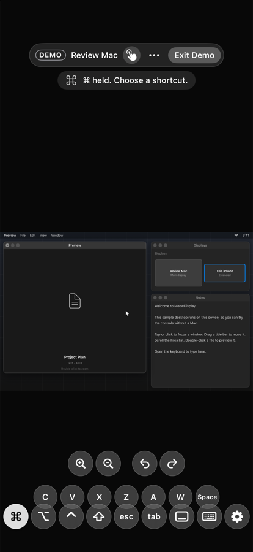 | 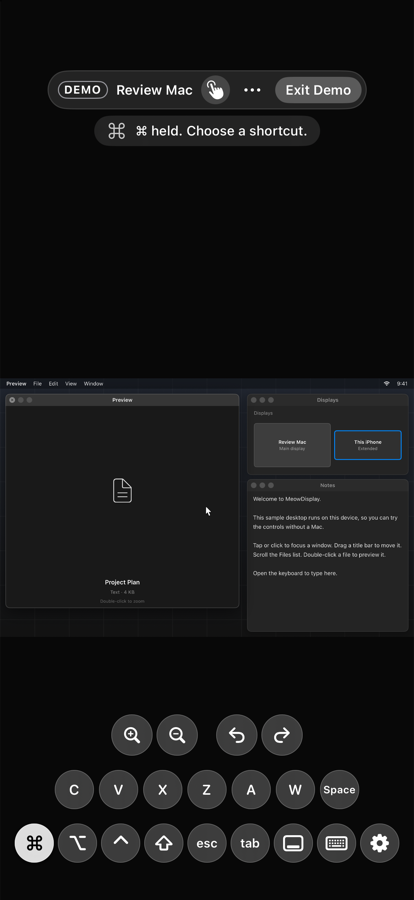 |

### 2. The default iPhone tray ran off 390 pt and 402 pt screens

Nine 40 pt chips need 396 pt. On iPhone 17e (390 pt) ⌘ and Settings were cut
off at the edges in portrait, and at the top and bottom in landscape. The
geometry clamps the tray's touch frame to the screen minus margins, so the
outer halves of those chips also didn't respond to touches.

Fix: `ControlTrayGeometry.fittedChipDiameter` shrinks the chips just enough
to fit (36 pt on a 390 pt phone, 38 pt on a 402 pt phone, never below 30 pt).
Trays that already fit are unchanged.

| Before (iPhone 17e) | After |
|---|---|
| 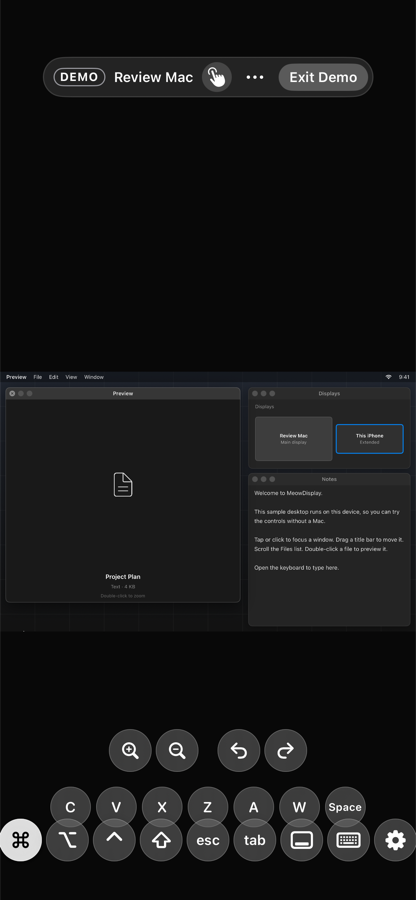 | 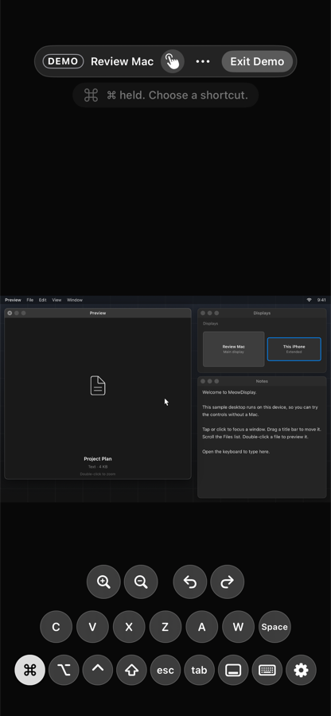 |
| 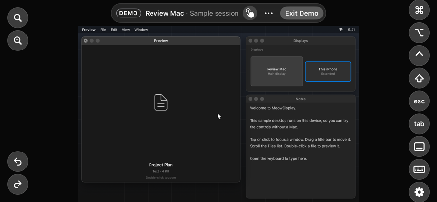 | 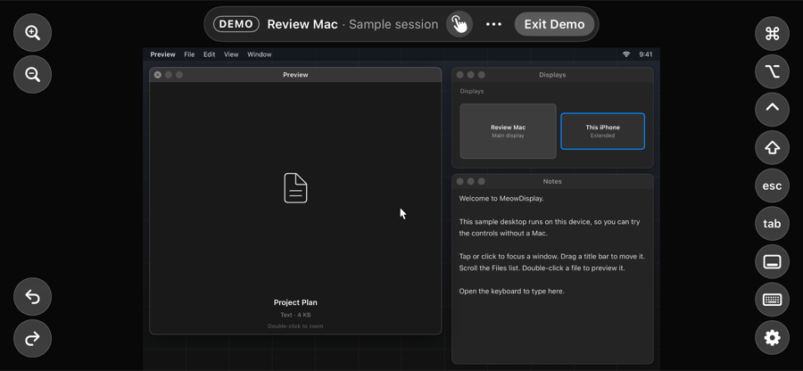 |

### 3. Tray controls weren't buttons to VoiceOver, Voice Control or Switch Control

The tray chips are drawn views. Taps reach them through one hit-testing
gesture, so assistive technologies saw labelled text with no button trait and
no action. The Main Tray, keyboard bar, palette keys and iPad Main controls
now carry the button trait and their tap action: a modifier latches, a
palette key fires its shortcut. `testTrayControlsAreAccessibilityButtons`
failed on the shipped build ("Command is not exposed as a button") and passes
now.

### 4. Demo Mode hid the keyboard bar behind the keyboard

Demo Mode passed the keyboard's own frame where the overlay expects the
visible area above it. The modifier/esc/tab bar was laid out behind the
keyboard, and the trays vanished while typing, on iPhone and iPad alike. Demo
Mode is what App Review and first-time users try, so this mattered. Live
sessions were not affected.

| Before | After |
|---|---|
| 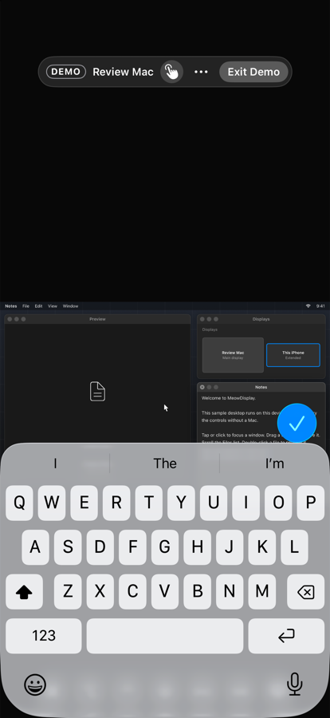 | 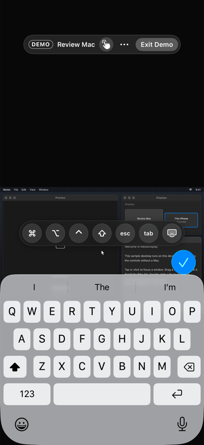 |

### 5. The Explore Demo card hid its button

The card wrapped its `Button` in a separate accessibility element. VoiceOver
got a plain group, and on iOS 27.1 the existing App Review smoke tests could
no longer find `app.buttons["Explore Demo"]`. The button now carries the label
itself.

### 6. iPad started on Strip, not the radial layout

A fresh iPad install (and Demo Mode) opened on Strip. The radial bottom-right
layout only existed once a Custom layout had been created. A fresh iPad now
starts on the radial Custom layout, with Strip and Overlay still in Settings ›
Controls › Control Layout. Saved preferences are never replaced, and iPhone
is unchanged.

| Before: Strip (iPad Air 11) | After: radial Custom (iPad Pro 13) | After: windowed (iPad Air 11) |
|---|---|---|
| 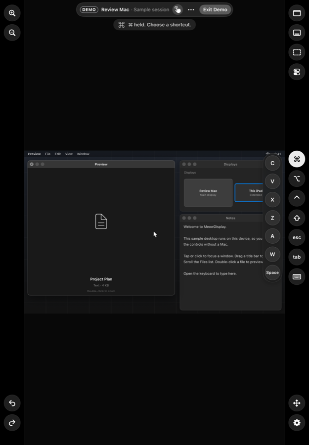 | 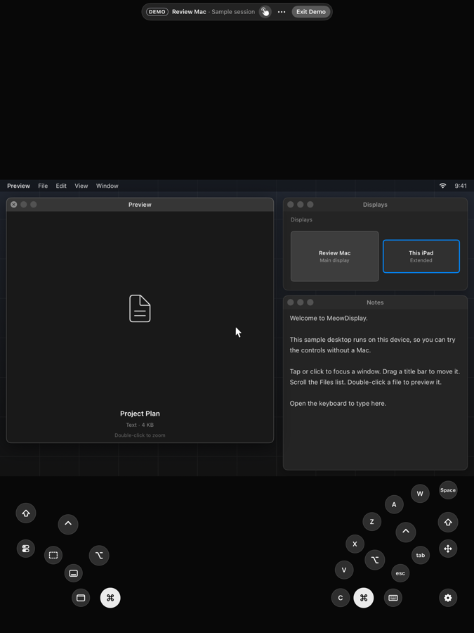 | 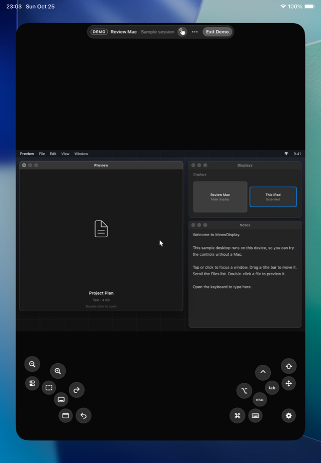 |

The radial layout follows the window when iPadOS runs the app windowed (third
image). Two-Hand Assist mirrors the modifiers on the left, and ⌘'s palette
fans out around the cluster.

### 7. Demo Mode's banner broke at accessibility text sizes

At the largest text size the fixed-height Demo banner's text overflowed and
covered **Exit Demo**, and the status chip wrapped as "Al- low In- put" over
the desktop. The banner is now capped at `xxLarge` and the chips at
`xxxLarge`. Settings and the home screen still scale fully.

| Before (iPhone 17, largest accessibility size) | After |
|---|---|
| 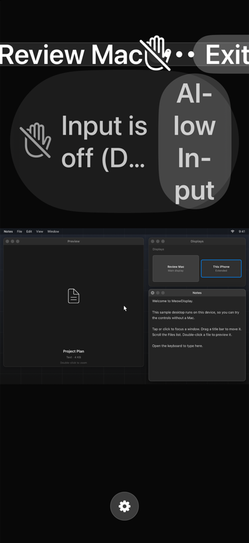 | 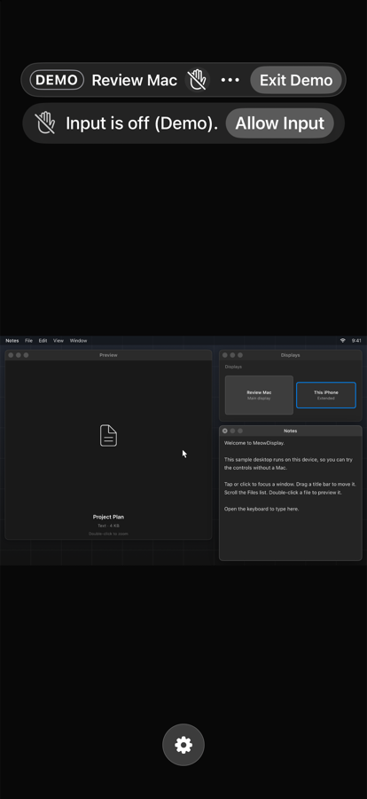 |

### 8. There was no Return key on the touch controls

Submitting a form, a chat message or a terminal command needed the software
keyboard, even with ⌘ latched for ⌘↵. Return is now in three places, all
sending one ordinary Return press (HID usage 40) through the existing
keyboard path:

- **Function Tray:** a built-in Return action in its own group after
  Undo/Redo, so a reach for Redo can't submit. Visible on fresh installs.
  Saved Function Tray profiles keep their layout exactly; Return is added
  hidden, ready to switch on in the editor.
- **Keyboard bar:** between tab and Hide Keyboard. With eight keys the bar
  fits by shrinking: 35 pt keys on a 375 pt iPhone, 37 pt on 390 pt, 38 pt
  (unchanged) from 402 pt up, never below 30 pt.
- **iPad radial layout:** in Two-Hand Assist's idle arc for new radial
  layouts. Saved Custom layouts keep their own arc.

Return has no modifiers of its own. A modifier latched on the tray is held
on the Mac, which merges it into the press, so ⌘ then ↵ is ⌘↵ and ⇧ then ↵
is ⇧↵. The press is a single down/up pair under one lock on the Mac, so it
can't leave a key held. It's sent only while input is allowed, and the Mac
enforces the grant again.

The Function Tray chips (iPhone and iPad) and the iPad Wheel palette's
wedges now perform their action for VoiceOver, Voice Control and Switch
Control, instead of only being labelled. On iPad, the chip's
`.accessibilityElement(children: .ignore)` had dropped its tap action.

| Function Tray, iPhone 17e (390 pt) | Keyboard bar, iPhone SE (375 pt) | Radial layout, iPad Pro 13 |
|---|---|---|
| 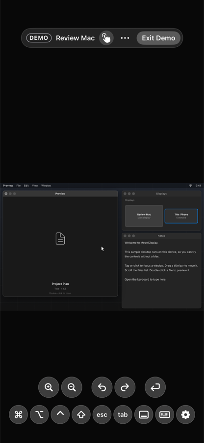 | 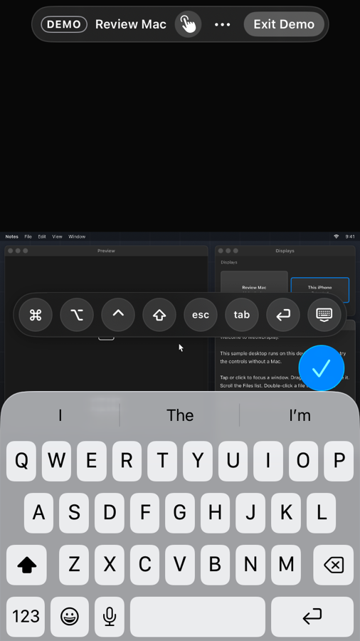 | 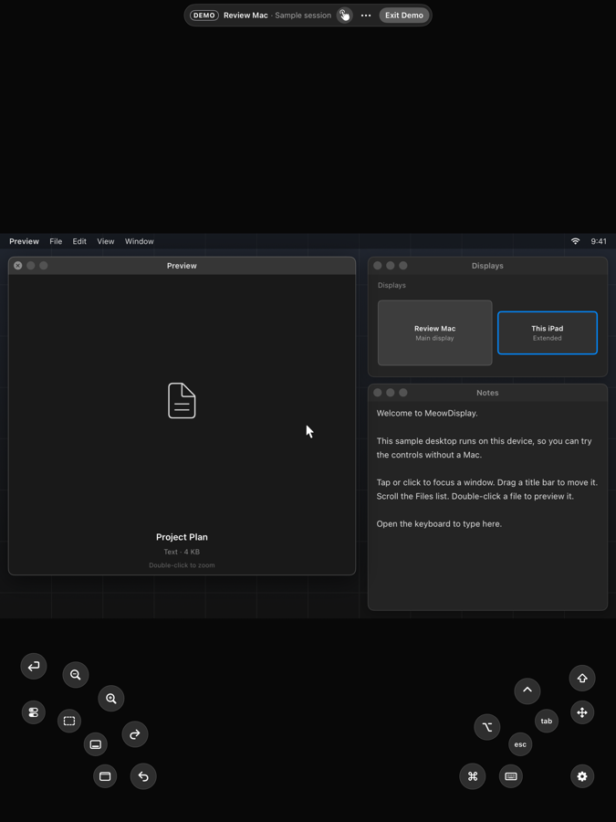 |

### 9. Rotated video could be panned off screen; zoom stopped at 3×

Manual viewport zoom now goes to **8×** (it was 3×). Zoom While Typing keeps
its own 1.5× limit, and App Gesture Commands are unchanged. Zoom is a layer
transform, so the stream resolution, decoding and networking don't change
(see the [performance audit](ios-control-surface-performance.md) for what it
does change).

Raising the cap exposed a pre-existing bug. Pan limits came from the rotated
picture's bounding box, so a tilted picture dragged along a diagonal could
leave the screen entirely, and the gap grew with zoom. The clamp now works in
the picture's own rotated frame. The point under the view's center is the
nearest point on the picture, so the picture can't be lost at any angle or
zoom. At 0°, 90° and 180° the result is identical to before.
Re-clamping an in-range state (restore, relayout) leaves it exactly as it was.

| 8× with Move View dragged to the edge, iPad Pro 13 |
|---|
| 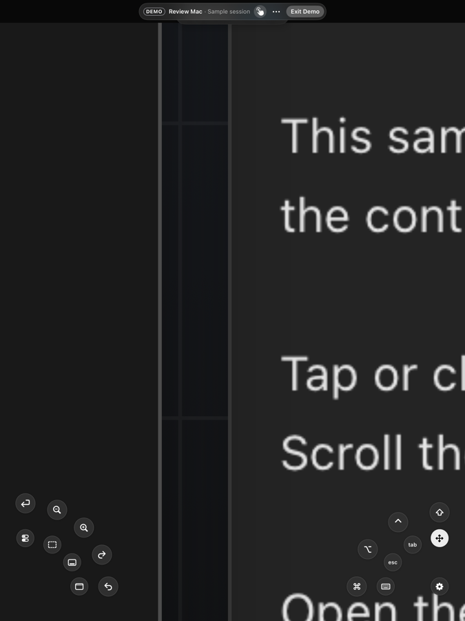 |

### Noted, not changed

- **Precise Control is invisible in the app.** One footnote under Input Mode
  would help. The feature works; it just isn't discoverable.
- **Keyboard bar gap:** on iPhone the bar sits roughly 60 pt above the keyboard
  in the simulator. Check on hardware before changing anything.
- **Fixed-size chip glyphs:** chips over live video ignore Dynamic Type by
  design. Settings, the input prompt and the interruption overlay use system
  text styles.
- **`DemoModeSmokeTests` on a 375 pt iPhone:** on the iPhone SE (3rd
  generation) simulator, the landscape run doesn't find the Settings ›
  Gestures row while scrolling the short list (cause not confirmed). Two
  test-side scrolling fixes didn't hold on both orientations and were
  reverted. The test passes on every larger device; Settings itself is
  unchanged on this branch.

## Control Surface mode

There is no need for a new mode. **Video Off** already turns the device into
a trackpad and control panel: trays, Function Tray, keyboard and input mode
stay live, and a trackpad preview replaces the picture. Making it a first-class
"Control Surface" would mostly mean making it easier to find, for example a
Function Tray action that toggles video. That needs no protocol change, but it
is a product decision, so it isn't in this branch.

## Hardware-only checklist

- [ ] iPhone with a home indicator, portrait: hold ⌘. The palette sits clear
      above the tray, with no overlap, and sliding to a key fires it.
- [ ] Same in landscape with the notch on each side (rotate both ways).
- [ ] 390 pt / 375 pt iPhone: every tray chip is fully on screen, and tapping
      the outer edge of ⌘ and Settings works.
- [ ] VoiceOver: swipe through the tray. Each control reads as a button;
      double-tap ⌘ latches it (Mac receives ⌘ down), double-tap again
      releases; double-tap a palette key sends the shortcut.
- [ ] Voice Control: "Tap Command", "Tap Settings", "Tap Escape".
- [ ] Switch Control: scan to the tray and activate a modifier and Settings.
- [ ] Fresh iPad install: the radial bottom-right layout appears; switching
      to Strip/Overlay and back works; an existing install keeps its layout.
- [ ] Live session keyboard bar on iPhone and iPad: position relative to the
      keyboard (see the gap note above).
- [ ] Live session at the largest accessibility text size: the on-surface
      Request Input prompt and the interruption card stay legible and
      tappable (Demo Mode has its own chips, so this couldn't be checked
      here).
- [ ] Return from the Function Tray, the keyboard bar and the iPad radial
      arc submits once in a Mac text field; ⌘ latched then ↵ sends ⌘↵, ⇧
      then ↵ sends ⇧↵, and nothing stays held afterwards.
- [ ] VoiceOver double-tap, "Tap Return" (Voice Control) and Switch Control
      on a Function Tray chip and an iPad Wheel wedge fire the action.
- [ ] Upgrade over v1.20.0 with a customized Function Tray: the tray is
      unchanged and Return is listed, hidden, in the editor.
- [ ] Pinch to 8× and back on a live Mac: smooth, anchored under the
      fingers, and taps land on the magnified control. Rotate, pan hard in
      every direction, rotate the device and open the keyboard while zoomed.
- [ ] Zoom cost on the live stream: the measurements in the
      [performance audit](ios-control-surface-performance.md#needs-hardware).
- [ ] Apple Pencil: pressure, tilt, hover and palm rejection on a supported
      iPad.
- [ ] Picture in Picture with a live Mac.
- [ ] Real network latency and touch feel for Direct Touch, Trackpad and
      Precise Control.
